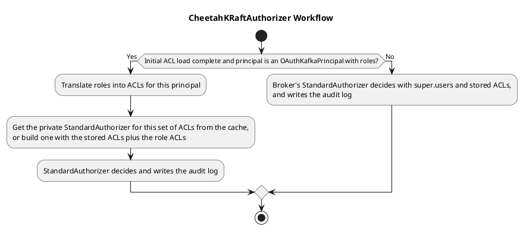
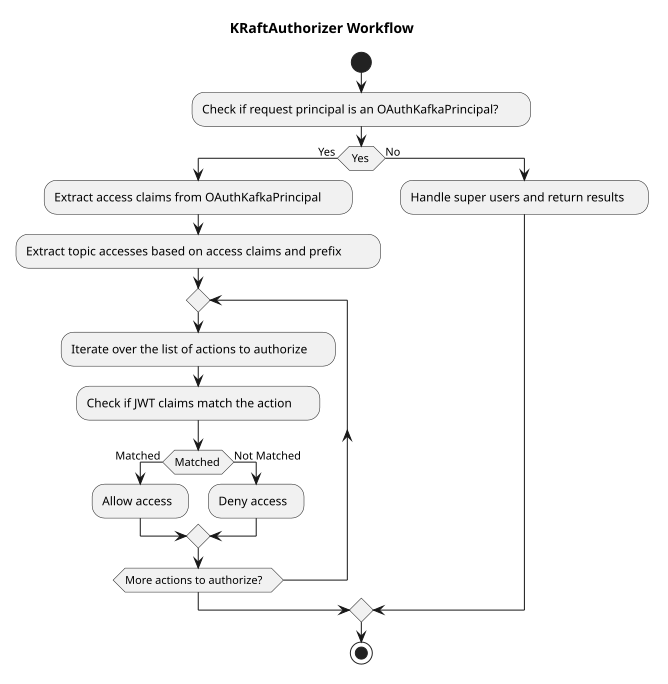

# Cheetah KRaft Kafka Authorizer

`CheetahKRaftAuthorizer` gives OAuth clients access to Kafka based on roles in their JWT. It uses `OAuthKafkaPrincipalBuilder` from <https://github.com/strimzi/strimzi-kafka-oauth/tree/main>, which validates the JWT and creates an `OAuthKafkaPrincipal` for each connection.

The authorizer does not make access decisions itself. It translates the roles of an OAuth principal into Kafka ACLs, and Kafka's own `StandardAuthorizer` decides with those ACLs plus any ACLs stored in KRaft. Because Kafka decides, Kafka also writes its normal authorization audit log (see [Logging](#logging)), and `super.users` and stored ACLs behave exactly as in a plain Kafka cluster.

> `CheetahKafkaAuthorizer` is a deprecated alias of `CheetahKRaftAuthorizer`, kept for configurations that still use the old class name.

Access is expressed through a claim in the JWT, either a comma-separated string or a list:

```json
{
  "iat": 1679325503,
  "sub": "a252a70e-363e-42aa-a62b-6f7f54d4c8bd",
  ...
  "roles": ["Kafka_*_read", "Kafka_MyTopic_all", "Kafka_YourTopic_write"]
}
```

Each role has the following pattern:

`<prefix>_<topic-name>_<operation>`

The `<prefix>` is optional and can be configured; it is matched with or without the trailing `_`. Roles without the prefix are ignored. The `<topic-name>` may contain `_`; the operation is the part after the last `_`.

The `<operation>` is translated directly into a Kafka ACL operation. See <https://kafka.apache.org/documentation/#operations_in_kafka> for the operations each request needs.

**NB:** It is transformed into uppercase and `-` is replaced with `_`.
Example: `Kafka_mytopic_describe-configs` becomes a `DESCRIBE_CONFIGS` ACL for the topic called `mytopic`. `any` is treated as `all`.

The `<topic-name>` can be:

- a topic name, for example `orders`;
- `*` for all topics;
- a prefix ending with `*`, for example `orders*` for all topics starting with `orders`.

A `*` anywhere else, for example `*orders`, is not supported by Kafka and the role is ignored.

## Resource types

### Topics

A role gives the principal an ACL with that operation on the topic. Kafka itself lets `READ`, `WRITE`, `DELETE` and `ALTER` imply `DESCRIBE`, and `ALTER_CONFIGS` imply `DESCRIBE_CONFIGS`.

To support consumers, some operations also give access to consumer groups. The group name is not checked; access applies to every group.

#### Type: READ

Example: `Kafka_mytopic_read`

| Kafka Resource | Allows requested Action |
|----------------|-------------------------|
| Topic          | READ, DESCRIBE          |
| Group          | READ, DESCRIBE          |

Use this for services that consume data from Kafka.

#### Type: WRITE

Example: `Kafka_mytopic_write`

| Kafka Resource | Allows requested Action |
|----------------|-------------------------|
| Topic          | WRITE, DESCRIBE         |

Idempotent producers are allowed without a cluster role: Kafka accepts `WRITE` on any topic in place of `IDEMPOTENT_WRITE` on the cluster.
Use this for services that produce data to Kafka.

#### Type: ALL

Example: `Kafka_mytopic_all`

| Kafka Resource | Allows requested Action |
|----------------|-------------------------|
| Topic          | ALL                     |
| Group          | READ, DESCRIBE, DELETE  |

This supports producers and consumers and gives them more control over topics, such as altering topic configuration. It does not give access to the cluster.

`describe` and `delete` roles also give `DESCRIBE` and `DELETE` on groups.

### Cluster

A role of the form `<prefix>_Cluster_<operation>` (`Cluster` is case-insensitive) gives an ACL with that operation on the cluster, for example `Kafka_Cluster_create` or `Kafka_Cluster_describe-configs`. As a consequence, a topic whose name starts with `Cluster_` cannot be addressed by a role.

### Super users and stored ACLs

`super.users` is handled by Kafka and applies to every principal type, including OAuth principals. ACLs created with `kafka-acls` (or Strimzi `KafkaUser` resources) also apply, including `DENY` ACLs, which take precedence over the roles.

## Workflow

Workflow for CheetahKRaftAuthorizer:





The private authorizers are needed because Kafka's `StandardAuthorizer` expects ACLs to be changed by a single thread (the metadata thread). Adding the role ACLs to the broker's shared authorizer for each request, from several request threads, loses updates and leaves permissions behind.
The cache is cleared whenever the stored ACLs change. See [`spike/`](./spike/README.md) for the checks behind this design.

# Deployment

Configure the Claim in JWT to look for topic access by setting:
`cheetah.authorization.claim.name=<claimName>`

If the claims have a prefix before the topic name (i.e. `Kafka_MyTopicName_Read` ), this can be configured by setting:
`cheetah.authorization.prefix=<prefix>`

If the claim is a list of accesses instead of a string of comma-separated accesses you can set
`cheetah.authorization.claim.is-list=true`

The maximum number of cached private authorizers (default 1000) can be set with
`cheetah.authorization.cache.max-entries=<number>`. When it is reached, the cache is cleared.

To use the Authorizer package the project using maven:

`mvn package`

Then

`docker build . -t my-kafka`

## Logging

Kafka's `StandardAuthorizer` writes one audit line per authorized action on the logger `kafka.authorizer.logger`:

### DEBUG

- Allowed actions, including super users (`based on rule SuperUser`). The logger must be at DEBUG to record them.

### INFO

- Denied actions.
- Roles that do not follow the pattern `<prefix>_<topic-name>_<operation>`, or have an unknown or unsupported operation or wildcard (logger `com.trifork.cheetah`).
- Building a private authorizer (logger `org.apache.kafka.metadata.authorizer.StandardAuthorizerData`): once per distinct set of roles per broker, and again after stored ACLs change.

### WARN

- JWT does not have the required claim.
